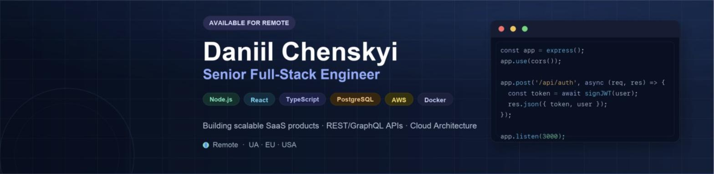

```
$ ./daniil --init

[ok] loading coffee.exe ......... done
[ok] loading typescript ......... done
[warn] loading sleep.exe ........ skipped (deadline tomorrow)
[ok] loading patience.exe ....... done (retry x3)

> whoami       Daniil Chenskyi
> title        Senior Full-Stack Engineer
> location     Ukraine · Remote EU/US/UA
> status       open to work · shipping anyway
```

---

### STACK

```
language → TypeScript
web      → React · Next.js
server   → Node.js · Express · NestJS · REST · GraphQL
data     → PostgreSQL · MongoDB · Redis
cloud    → AWS · Azure · Docker
```

---

### CONTACT

```
github   → github.com/diniilchenskyi
linkedin → linkedin.com/in/daniil-chenskyi
email    → diniilchenskyi@gmail.com
```

---

```
// 99 little bugs in the code, 99 little bugs...
// take one down, patch it around — 127 little bugs in the code
```
