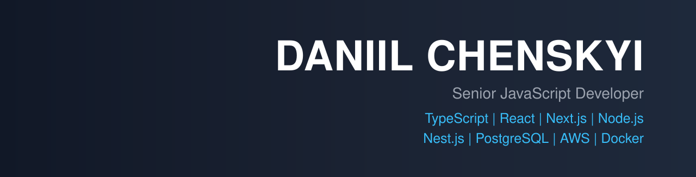

```
$ ./daniil --init

[ok] loading coffee.exe ......... done
[ok] loading typescript ......... done
[ok] loading patience.exe ....... done (retry x3)

> whoami      Daniil Chenskyi
> title       Senior Full-Stack Engineer
> focus       AdTech & FinTech
> location    Lviv, Ukraine · Remote (EU / UA)
> status      open to work

STACK
language  → TypeScript · JavaScript
web       → React · Next.js
server    → Node.js · Express · REST APIs · WebSockets
data      → PostgreSQL · Redis · Sequelize
adtech    → Prebid.js · Header Bidding · Ad Reporting (impressions, revenue, eCPM)
fintech   → Payment webhooks · Idempotency · Reconciliation
cloud     → AWS · Docker · CI/CD

EXPERIENCE
TeqBlaze   → white-label publisher portal, auction config, Prebid.js, ad reporting
Slope      → B2B buyer portal, Checkout.com webhooks, payment reconciliation
LITIKO     → contract approval & document workflow system

AI TOOLING
claude code · cursor · codex · gemini · google antigravity

CONTACT
linkedin  → linkedin.com/in/daniil-chenskyi
email     → diniilchenskyi@gmail.com
```
